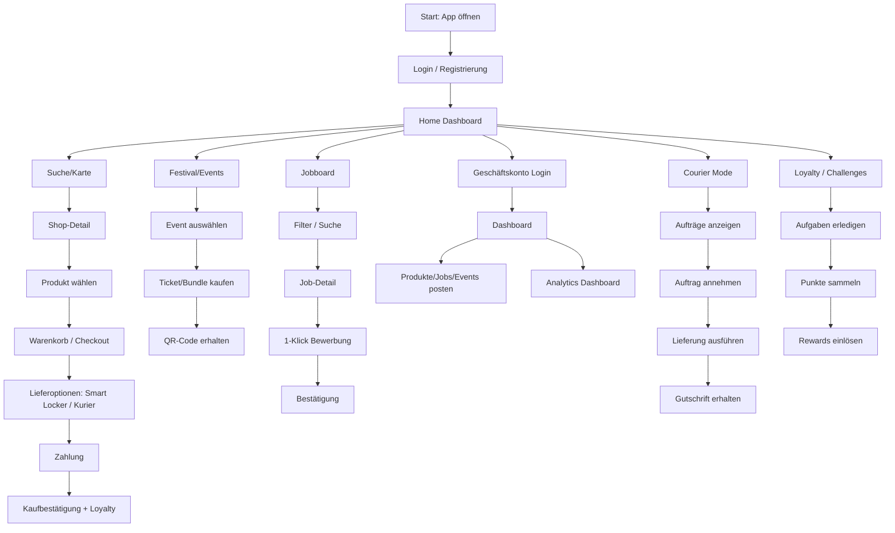

# User Journey Map (docs/ux.md)

| Persona              | Ziel (هدف)                                   | Touchpoints (نقاط تماس)                                                                 | Outcome (نتیجه / ارزش)                          |
|----------------------|-----------------------------------------------|------------------------------------------------------------------------------------------|------------------------------------------------|
| **Local Shopper**    | Produkte von lokalen Shops entdecken & kaufen | Home → Suche/Karte → Shop-Detail → Warenkorb → Checkout → Lieferung/Smart Locker          | Einfache Entdeckung, günstige Deals, bequeme Lieferung |
| **Event Visitor**    | Teilnahme an lokalen Festivals & Events        | Festival/Events → Event auswählen → Angebote/Tickets → Checkout → QR-Code                 | Direkter Zugang zu Events, Verbindung digital ↔ physisch |
| **Job Seeker**       | Lokale Jobs finden (flexibel, Teilzeit, Gig)   | Jobboard → Filter/ Suche → Job-Detail → Bewerbung mit 1 Klick → Bestätigung              | Zugang zu Jobs in der Nähe, schnelle Bewerbung |
| **Local Merchant**   | Sichtbarkeit steigern, Produkte & Jobs posten  | Geschäftskonto Login → Dashboard → Produkte/Jobs/Events hinzufügen → Analytics Dashboard | Mehr Reichweite, besseres Inventarmanagement   |
| **Courier/Driver**   | Geld verdienen durch lokale Lieferungen        | Courier Mode → Aufträge anzeigen → Auftrag annehmen → Lieferung ausführen → Gutschrift   | Flexible Einkünfte, Teil des lokalen Ökosystems |
| **Community User**   | Teilhabe an Community, Belohnungen sammeln     | Home → Challenges / Loyalty → Aufgaben erledigen → Punkte sammeln → Rewards einlösen     | Bindung an Plattform, Spaß & Belohnung         |

---

## User Flow Diagram

